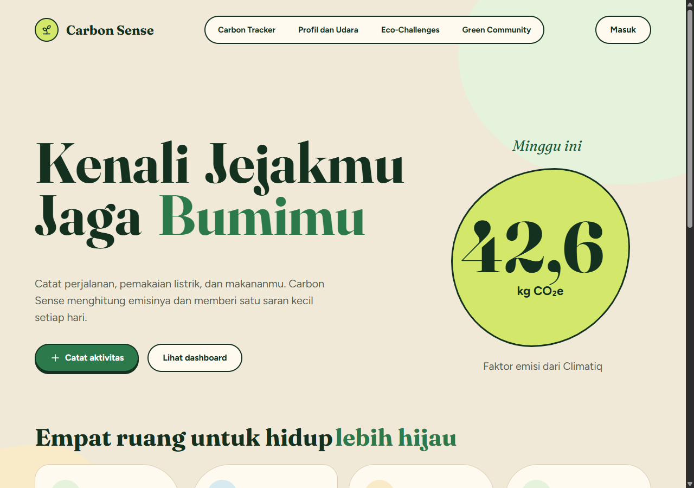
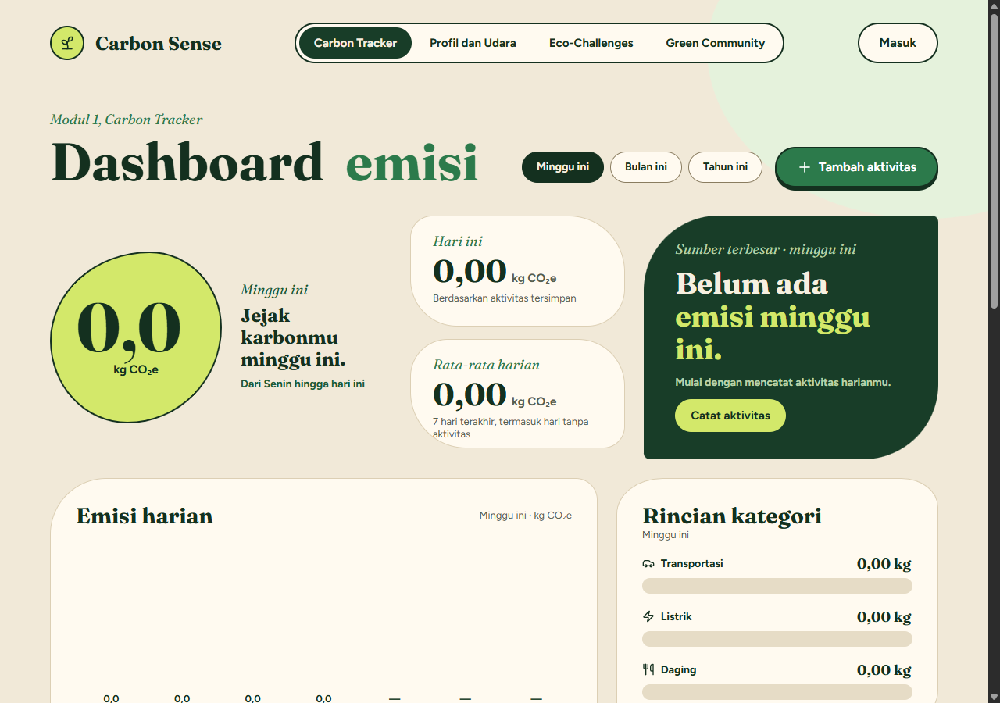
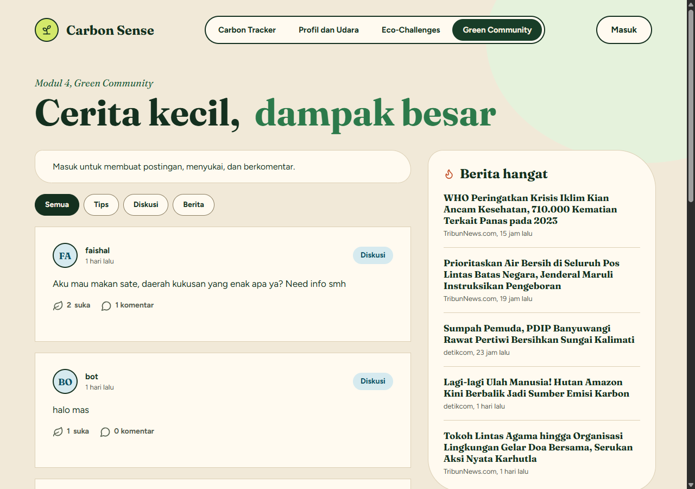
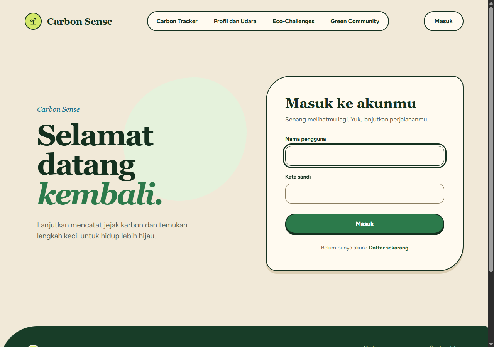

# Carbon Sense

**Aplikasi Web Pelacak Jejak Karbon Harian & Gamifikasi Ramah Lingkungan**

> **Tautan Deployment:** [http://faishal-falih-carbon-sense.pws.cs.ui.ac.id/](http://faishal-falih-carbon-sense.pws.cs.ui.ac.id/)

---

## Anggota Kelompok (PBP B-11)

| Nama | NPM | Modul Tanggung Jawab |
| :--- | :---: | :--- |
| **Putu Rizki Manik Widiadnyana** | 2506621900 | Modul 1: Carbon Tracker |
| **Faishal Falih** | 2506612064 | Modul 2: Profile & Environment Settings |
| **M Naufal Abyaz Bawono** | 2506656993 | Modul 3: Eco-Challenges (Gamifikasi) |
| **M. Fatih Danika** | 2506532100 | Modul 4: Green Community |

---

## Deskripsi Aplikasi

**Carbon Sense** adalah platform web yang membantu mahasiswa dan pekerja muda perkotaan mencatat aktivitas harian, menghitung jejak emisi karbon (dalam satuan kg CO₂e), serta mendorong perubahan kebiasaan ramah lingkungan melalui tantangan harian (gamifikasi), pemantauan kualitas udara, dan dukungan komunitas hijau.

### Peran Pengguna (User Roles & Personas)
1. **Pengguna Biasa (Komuter / Mahasiswa / Urban Worker):**
   - Mendaftarkan akun, masuk, dan mengatur kota domisili serta target emisi mingguan.
   - Mencatat log aktivitas harian (transportasi, konsumsi listrik, dan makanan) secara cepat.
   - Mengikuti misi hijau pada katalog tantangan, melakukan check-in harian, menjaga streak, dan mengoleksi lencana prestasi.
   - Membaca berita lingkungan dan berinteraksi di linimasa komunitas.
2. **Administrator / Superuser:**
   - Memiliki wewenang kurasi dan manajemen penuh terhadap katalog tantangan (menambah, mengubah, dan menghapus tantangan) melalui antarmuka web yang terproteksi.

---

## Tampilan Antarmuka Aplikasi

| Beranda | Eco-Challenges (Modul 3) |
| :---: | :---: |
|  |  |

| Carbon Tracker (Modul 1) | Green Community (Modul 4) |
| :---: | :---: |
|  |  |

| Profil & Kualitas Udara (Modul 2) |
| :---: |
|  |

---

## Daftar Modul & Komponen CRUD

### 1. Modul "Carbon Tracker" (Pencatat Jejak Karbon)
- **Fokus Utama:** Fitur inti untuk mencatat emisi harian pengguna (transportasi, listrik, daging ayam dan sapi).
- **Komponen CRUD:**
  - **Create:** Menambahkan log aktivitas karbon (misal: "Naik mobil 15 km").
  - **Read:** Menampilkan tabel riwayat aktivitas dan total emisi (Dashboard).
  - **Update:** Mengedit log aktivitas jika salah ketik.
  - **Delete:** Menghapus log dari riwayat.

Input Tracker menggunakan kilometer untuk mobil, kWh untuk listrik, serta perkiraan gram daging mentah untuk ayam dan sapi (bukan berat seluruh hidangan). Pilihan cepat 100 g, 150 g, dan 200 g adalah perkiraan yang dapat diubah pengguna, bukan ukuran porsi baku.

Estimasi daging menggunakan faktor total terpisah untuk ayam dan sapi dari CONCITO/2-0 LCA, Big Climate Database v1.2, wilayah Prancis, tahun 2024, melalui Climatiq. Faktor ini merupakan perkiraan referensi, bukan faktor khusus Indonesia atau perhitungan seluruh resep. Berat dikirim ke API dalam gram dan kedua jenis daging digabungkan pada kategori dashboard **Daging**. Sumber: [Big Climate Database](https://thebigclimatedatabase.com/).

### 2. Modul "Profile & Environment Settings" (Profil & Widget Udara)
- **Fokus Utama:** Manajemen akun pengguna dan pusat pengaturan lokasi (koordinat kota) yang menyuplai data lokasi untuk modul lain.
- **Komponen CRUD:**
  - **Create:** Membuat entitas UserProfile saat pertama kali registrasi (mengatur kota domisili).
  - **Read:** Menampilkan halaman profil, data diri, dan merender widget cuaca/kualitas udara via Open-Meteo API.
  - **Update:** Form untuk mengubah Email, Password, Bio, dan Kota Domisili.
  - **Delete:** Fitur hapus akun secara permanen.

### 3. Modul "Eco-Challenges" (Gamifikasi & Tantangan)
- **Fokus Utama:** Menyediakan misi/tantangan harian yang harus diselesaikan pengguna untuk mengurangi emisi dan membangun kebiasaan hijau.
- **Komponen CRUD:**
  - **Create:** Pengguna mendaftar (*join*) ke sebuah tantangan yang tersedia. Superuser dapat membuat tantangan baru ke dalam katalog.
  - **Read:** Menampilkan katalog tantangan dengan filter kategori dinamis (AJAX/Fetch tanpa reload), detail tantangan aktif, bilah progres, status titik harian (*dots*), total poin, streak berturut-turut, serta galeri lencana prestasi (8 lencana).
  - **Update:** Pengguna menekan tombol "Check-in" untuk menambah progres harian tantangan secara asinkron (didukung *optimistic UI*). Superuser dapat mengedit detail tantangan di katalog.
  - **Delete:** Pengguna dapat membatalkan/berhenti dari tantangan di tengah jalan (*soft-delete* status partisipasi). Superuser dapat menghapus tantangan dari katalog.

### 4. Modul "Green Community" (Forum & Hot News)
- **Fokus Utama:** Ruang sosial (*feed*) bagi pengguna untuk berbagi tips dan berdiskusi isu lingkungan.
- **Komponen CRUD:**
  - **Create:** Membuat postingan (tips, diskusi, atau *share link* berita dari GNews API).
  - **Read:** Menampilkan feed publik berisi postingan pengguna lain dan kolom berita iklim.
  - **Update:** Mengedit isi postingan sendiri.
  - **Delete:** Menghapus postingan sendiri.

---

## Integrasi Data Eksternal & Public API

- **Open-Meteo (Weather & Air Quality):** [https://open-meteo.com/](https://open-meteo.com/) — Digunakan pada Modul Profil untuk menyajikan indeks kualitas udara (AQI), suhu, kecepatan angin, dan kondisi cuaca berdasarkan kota domisili pengguna.
- **GNews API:** [https://gnews.io/](https://gnews.io/) — Digunakan pada Modul Green Community dan Beranda untuk menampilkan berita iklim dan lingkungan terkini secara terkurasi.
- **Climatiq Carbon Calculator API:** [https://www.climatiq.io/docs/api-reference](https://www.climatiq.io/docs/api-reference) — Digunakan pada Modul Carbon Tracker untuk menghitung estimasi emisi gas rumah kaca berbasis faktor emisi standar.

---

## Panduan Instalasi & Menjalankan Proyek (Setup Instructions)

### 1. Prasyarat Sistem
- Python 3.10, 3.11, atau 3.12
- Git
- Web browser modern (Chrome, Edge, Firefox, Safari)

### 2. Kloning Repositori
```bash
git clone https://github.com/PBP-B-11/carbon-sense.git
cd carbon-sense
```

### 3. Buat dan Aktifkan Virtual Environment
- **Windows (PowerShell):**
  ```powershell
  python -m venv env
  .\env\Scripts\Activate.ps1
  ```
- **macOS / Linux:**
  ```bash
  python3 -m venv env
  source env/bin/activate
  ```

### 4. Pasang Dependensi
```bash
pip install -r requirements.txt
```

### 5. Konfigurasi Environment Variable (Opsional)
Buat berkas `.env` pada direktori utama bila ingin menggunakan API eksternal secara penuh:
```env
CLIMATIQ_API_KEY=your_climatiq_api_key
GNEWS_API_KEY=your_gnews_api_key
PRODUCTION=False
```

### 6. Migrasi Basis Data & Seeding Data Awal
Jalankan migrasi basis data dan populate data katalog tantangan serta lencana bawaan:
```bash
python manage.py migrate
python manage.py seed_tantangan
```

### 7. Jalankan Server Pengembangan
```bash
python manage.py runserver
```
Buka browser dan akses aplikasi melalui `http://127.0.0.1:8000/`.

### 8. Menjalankan Pengujian Otomatis (Unit Tests)
```bash
python manage.py test
```
Untuk menguji modul spesifik (misal: Modul 3 Eco-Challenges):
```bash
python manage.py test challenges
```

---

## AI Disclosure (Pernyataan Penggunaan AI)

Sesuai dengan ketentuan transparansi akademik dan rubrik evaluasi proyek PBP:

### 1. Alat Bantu AI & Coding Assistant yang Digunakan
Secara kolaboratif, anggota tim memanfaatkan beberapa platform AI dan *coding assistant* untuk mendukung proses rekayasa perangkat lunak proyek Carbon Sense, antara lain:
- **Google Antigravity Coding Assistant**
- **Anthropic Claude**
- **OpenAI ChatGPT & GitHub Copilot**

Secara umum di seluruh modul, alat-alat bantu AI tersebut dimanfaatkan oleh tim untuk:
- Akselerasi penulisan kode *boilerplate* (seperti serializers data, skema model Django, dan formulir validasi).
- Perancangan arsitektur dan *refactoring* logika bisnis (seperti decorator keamanan, *rate limiting*, dan optimasi query).
- Pembuatan struktur awal template HTML/CSS berbasis desain sistem Figma serta interaktivitas JavaScript modular (*optimistic UI updates*).
- Penyusunan skenario pengujian unit (*test cases*) komprehensif untuk memvalidasi kasus batas (*boundary conditions*, hak akses pengguna, dan penanganan kode status HTTP).

### 2. Strategi Prompting Terstruktur
- **Specification-First Prompting:** Setiap permintaan ke AI diawali dengan menyertakan dokumen spesifikasi teknis (PRD/TRD), definisi model data, serta konvensi token desain Figma (`styles.css`) agar kode yang dihasilkan konsisten secara arsitektural.
- **Test-Driven Development (TDD) Prompting:** Asisten AI diarahkan untuk merumuskan test case lengkap terlebih dahulu (mencakup kasus positif, kasus batas, input tak valid, dan status HTTP 400, 401, 403, 404, 409, 429) sebelum logika view diimplementasikan.
- **Design System Conformance:** Instruksi prompt secara ketat membatasi AI agar menggunakan kelas komponen dan variabel CSS bawaan proyek tanpa memasukkan library CSS eksternal baru yang dapat merusak konsistensi tata letak.

### 3. Analisis Kritis Batasan AI (*AI Limitations*)
Dalam proses pengembangan, tim menemukan beberapa batasan nyata dari kode yang di-generate oleh AI:
1. **URL Routing Mismatch:** Asisten AI sempat menghasilkan pola URL terbalik pada kode JavaScript kartu dinamis (`/challenges/ubah/${id}/` alih-alih `/challenges/${id}/ubah/`), yang berpotensi menghasilkan galat 404 Not Found jika tidak diaudit secara teliti terhadap `urls.py`.
2. **State Leakage pada Cache Runner Unit Test:** Saat mengimplementasikan decorator *rate limiting*, AI tidak mengantisipasi bahwa backend `LocMemCache` pada Django test runner mempertahankan state antar-metode pengujian, sehingga pengujian berikutnya terkena pemblokiran 429 tanpa pembersihan cache yang eksplisit.
3. **Kerapuhan Tata Letak Responsif Mobile:** Template HTML yang diusulkan AI awalnya mengalami sedikit *overflow* pada layar sempit (<390px) karena ukuran padding yang terlalu kaku dan belum memperhitungkan *touch target* minimal 44px.

### 4. Verifikasi dan Intervensi Manual (*Manual Fixes*)
- Seluruh kode yang dihasilkan asisten AI tidak pernah langsung di-merge, melainkan wajib melalui peninjauan manual (*peer review*) oleh anggota tim di GitHub Pull Request.
- Anggota tim melakukan audit baris demi baris, memperbaiki rute URL di `challenges.js`, menambahkan manajemen isolasi cache (`cache.clear()`) pada test suite, serta menyesuaikan media query CSS secara mandiri.
- Setiap perubahan divalidasi kelulusannya melalui eksekusi pengujian otomatis (`python manage.py test`) dengan 45 test case berstatus lulus 100% serta pemeriksaan linter *Ruff* sebelum kode dipublikasikan ke branch utama.
