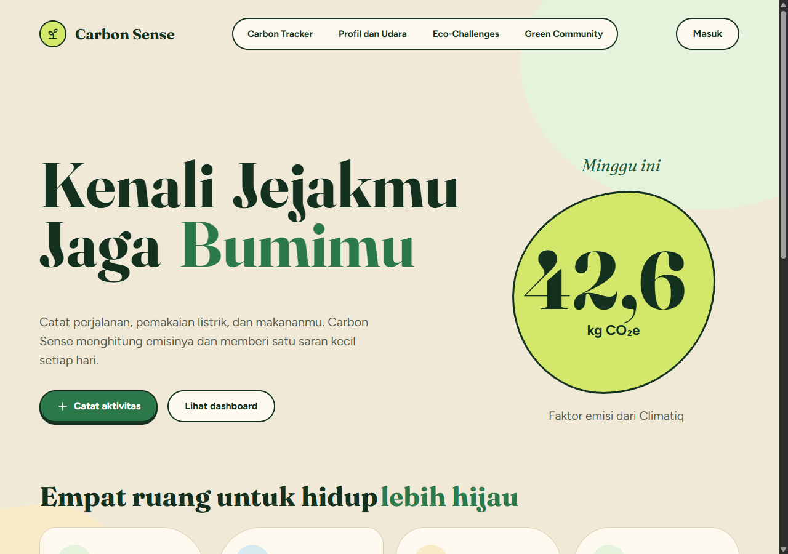
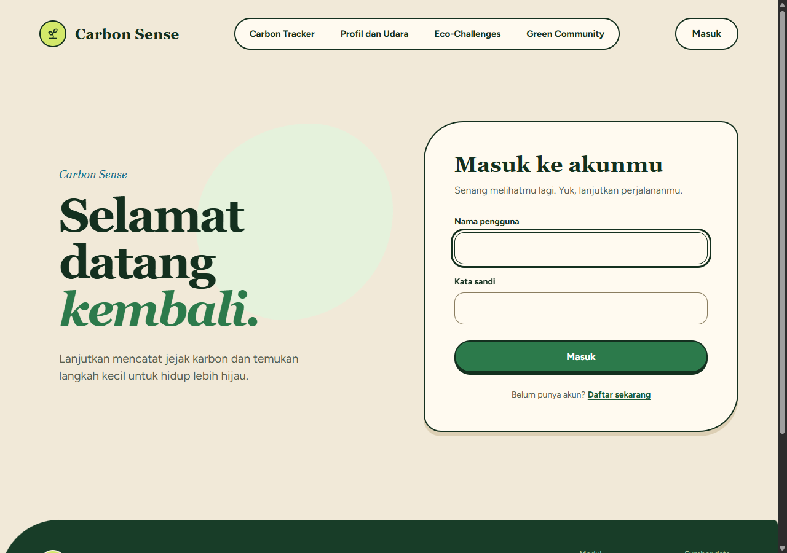
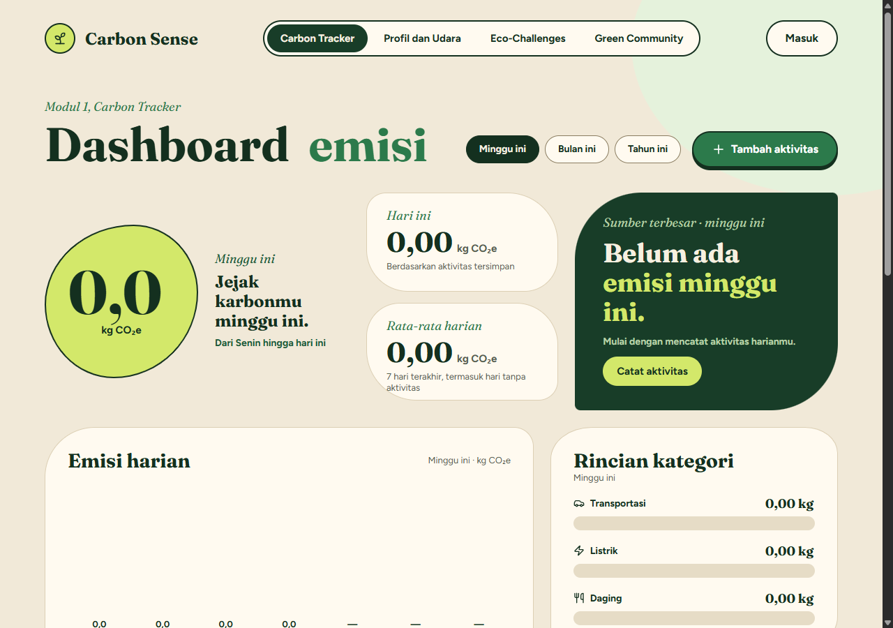
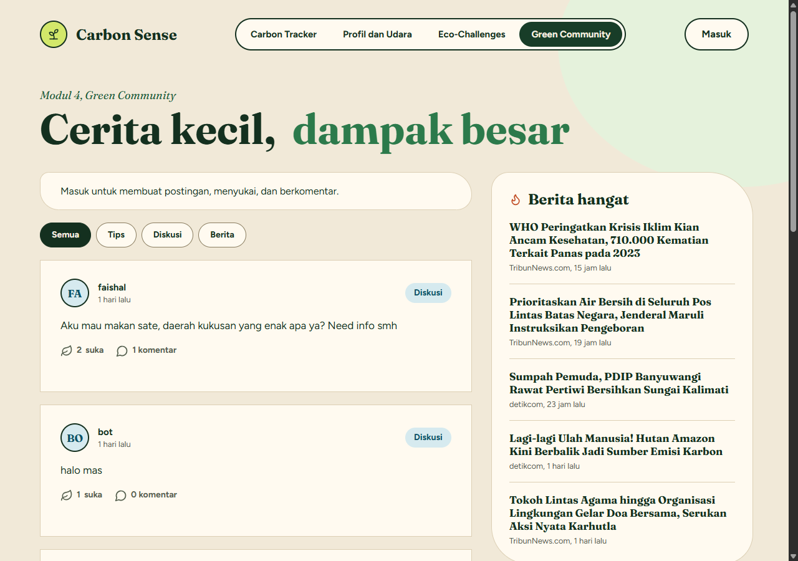
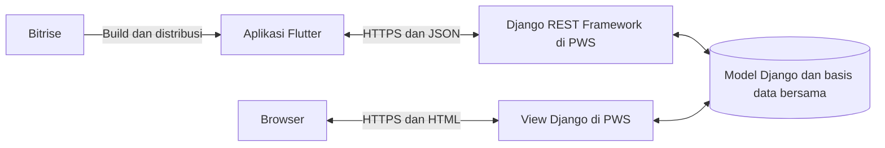

# Carbon Sense

**Aplikasi Web Pelacak Jejak Karbon Harian & Gamifikasi Ramah Lingkungan**

> **Tautan Deployment:** [http://faishal-falih-carbon-sense.pws.cs.ui.ac.id/](http://faishal-falih-carbon-sense.pws.cs.ui.ac.id/)

> **Tautan Figma:** [https://www.figma.com/design/YGZ8m922M5M7lBTRx4B9pE/Design-System-Carbon-Sense%5C?node-id=34-2&t=I44cmNm79RROIjzy-1](https://www.figma.com/design/YGZ8m922M5M7lBTRx4B9pE/Design-System-Carbon-Sense?node-id=34-2&t=E8dPkeL3XgQr08HM-1)
---

## Anggota Kelompok (PBP B-11)

| Nama | NPM | Modul Tanggung Jawab |
| :--- | :---: | :--- |
| **Putu Rizki Manik Widiadnyana** | 2506621900 | Modul 1: Carbon Tracker |
| **Faishal Falih** | 2506612064 | Modul 2: Profile & Environment Settings |
| **M Naufal Abyaz Bawono** | 2506656993 | Modul 3: Eco-Challenges (Gamifikasi) |
| **M. Fatih Danika** | 2506532100 | Modul 4: Green Community |

---

## Deskripsi Aplikasi

**Carbon Sense** adalah platform web yang membantu mahasiswa dan pekerja muda perkotaan mencatat aktivitas harian, menghitung jejak emisi karbon (dalam satuan kg CO₂e), serta mendorong perubahan kebiasaan ramah lingkungan melalui tantangan harian (gamifikasi), pemantauan kualitas udara, dan dukungan komunitas hijau.

### Peran Pengguna (User Roles & Personas)
1. **Pengguna Biasa (Komuter / Mahasiswa / Urban Worker):**
   - Mendaftarkan akun, masuk, dan mengatur kota domisili serta target emisi mingguan.
   - Mencatat log aktivitas harian (transportasi, konsumsi listrik, dan makanan) secara cepat.
   - Mengikuti misi hijau pada katalog tantangan, melakukan check-in harian, menjaga streak, dan mengoleksi lencana prestasi.
   - Membaca berita lingkungan dan berinteraksi di timeline komunitas.
2. **Administrator / Superuser:**
   - Memiliki wewenang kurasi dan manajemen penuh terhadap katalog tantangan di modul 3 (menambah, mengubah, dan menghapus tantangan) melalui antarmuka web yang terproteksi.

---

## Tampilan Antarmuka Aplikasi

| Beranda | Eco-Challenges (Modul 3) |
| :---: | :---: |
|  |  |

| Carbon Tracker (Modul 1) | Green Community (Modul 4) |
| :---: | :---: |
|  |  |

| Profil & Kualitas Udara (Modul 2) |
| :---: |
|  |

---

## Daftar Modul & Komponen CRUD

### 1. Modul "Carbon Tracker" (Pencatat Jejak Karbon)
- **Fokus Utama:** Fitur inti untuk mencatat emisi harian pengguna (transportasi, listrik, daging ayam dan sapi).
- **Komponen CRUD:**
  - **Create:** Menambahkan log aktivitas karbon (misal: "Naik mobil 15 km").
  - **Read:** Menampilkan tabel riwayat aktivitas dan total emisi (Dashboard).
  - **Update:** Mengedit log aktivitas jika salah ketik.
  - **Delete:** Menghapus log dari riwayat.

Input Tracker menggunakan kilometer untuk mobil, kWh untuk listrik, serta perkiraan gram daging mentah untuk ayam dan sapi (bukan berat seluruh hidangan). Pilihan cepat 100 g, 150 g, dan 200 g adalah perkiraan yang dapat diubah pengguna, bukan ukuran porsi baku.

Estimasi daging menggunakan faktor total terpisah untuk ayam dan sapi dari CONCITO/2-0 LCA, Big Climate Database v1.2, wilayah Prancis, tahun 2024, melalui Climatiq. Faktor ini merupakan perkiraan referensi, bukan faktor khusus Indonesia atau perhitungan seluruh resep. Berat dikirim ke API dalam gram dan kedua jenis daging digabungkan pada kategori dashboard **Daging**. Sumber: [Big Climate Database](https://thebigclimatedatabase.com/).

### 2. Modul "Profile & Environment Settings" (Profil & Widget Udara)
- **Fokus Utama:** Manajemen akun pengguna dan pusat pengaturan lokasi (koordinat kota) yang menyuplai data lokasi untuk modul lain.
- **Komponen CRUD:**
  - **Create:** Membuat entitas UserProfile saat pertama kali registrasi (mengatur kota domisili).
  - **Read:** Menampilkan halaman profil, data diri, dan merender widget cuaca/kualitas udara via Open-Meteo API.
  - **Update:** Form untuk mengubah Email, Password, Bio, dan Kota Domisili.
  - **Delete:** Fitur hapus akun secara permanen.

### 3. Modul "Eco-Challenges" (Gamifikasi & Tantangan)
- **Fokus Utama:** Menyediakan misi/tantangan harian yang harus diselesaikan pengguna untuk mengurangi emisi dan membangun kebiasaan hijau.
- **Komponen CRUD:**
  - **Create:** Pengguna mendaftar (*join*) ke sebuah tantangan yang tersedia. Superuser dapat membuat tantangan baru ke dalam katalog.
  - **Read:** Menampilkan katalog tantangan dengan filter kategori dinamis (AJAX/Fetch tanpa reload), detail tantangan aktif, bilah progres, status titik harian (*dots*), total poin, streak berturut-turut, serta galeri lencana prestasi (8 lencana).
  - **Update:** Pengguna menekan tombol "Check-in" untuk menambah progres harian tantangan secara asinkron (didukung *optimistic UI*). Superuser dapat mengedit detail tantangan di katalog.
  - **Delete:** Pengguna dapat membatalkan/berhenti dari tantangan di tengah jalan (*soft-delete* status partisipasi). Superuser dapat menghapus tantangan dari katalog.

### 4. Modul "Green Community" (Forum & Hot News)
- **Fokus Utama:** Ruang sosial (*feed*) bagi pengguna untuk berbagi tips dan berdiskusi isu lingkungan.
- **Komponen CRUD:**
  - **Create:** Membuat postingan (tips, diskusi, atau *share link* berita dari GNews API) dan komentar.
  - **Read:** Menampilkan feed publik berisi postingan pengguna lain dan kolom berita iklim.
  - **Update:** Mengedit isi postingan sendiri.
  - **Delete:** Menghapus postingan sendiri.

---

## Integrasi Data Eksternal & Public API

- **Open-Meteo (Weather & Air Quality):** [https://open-meteo.com/](https://open-meteo.com/) — Digunakan pada Modul 2 (Profil) untuk menyajikan indeks kualitas udara (AQI), suhu, kecepatan angin, dan kondisi cuaca berdasarkan kota domisili pengguna.
- **GNews API:** [https://gnews.io/](https://gnews.io/) — Digunakan pada Modul 4 (Green Community) dan Beranda untuk menampilkan berita iklim dan lingkungan terkini secara terkurasi.
- **Climatiq Carbon Calculator API:** [https://www.climatiq.io/docs/api-reference](https://www.climatiq.io/docs/api-reference) — Digunakan pada Modul 1 (Carbon Tracker) untuk menghitung estimasi emisi gas rumah kaca berbasis faktor emisi standar.

---

## Integrasi Flutter dengan Situs Web PWS

Flutter dan situs web Carbon Sense menggunakan backend Django serta basis data yang sama di PWS. Browser mengakses view Django dengan sesi login web. Flutter mengirim permintaan HTTPS ke Django REST Framework (DRF) dan menerima respons JSON. Keduanya menggunakan akun Django yang sama.



1. Pengguna Flutter masuk dengan username dan kata sandi akun web. DRF memvalidasi kredensial dan mengembalikan token. Flutter menyimpan token di penyimpanan aman perangkat, lalu mengirim header `Authorization: Token <token>` pada permintaan yang memerlukan akun.
2. Saat pengguna menyimpan aktivitas, misalnya, Flutter mengirim `POST /api/v1/tracker/activities/` dengan jenis, jumlah, dan tanggal aktivitas. Django memvalidasi data, menghitung emisi, lalu menyimpan aktivitas untuk akun tersebut. DRF mengembalikan data yang tersimpan dengan status `201 Created`.
3. Saat pengguna membuka ulang Tracker di situs web, view Django membaca aktivitas tadi dari basis data. Aktivitas yang dibuat lewat web juga muncul di Flutter pada permintaan API berikutnya. Pola yang sama berlaku untuk perubahan profil, progres tantangan, dan interaksi komunitas. Aplikasi memerlukan koneksi internet untuk membaca atau menyimpan data.
4. Bitrise menerima URL dasar API melalui konfigurasi build Flutter, misalnya `--dart-define=API_BASE_URL=https://faishal-falih-carbon-sense.pws.cs.ui.ac.id/api/v1/`. ID akun, kata sandi, dan token pengguna diperoleh saat aplikasi dijalankan. Django berjalan di PWS dan migrasi `python manage.py migrate` harus diterapkan di sana sebelum login mobile tersedia.

### Daftar endpoint DRF

Semua path pada tabel diawali `/api/v1`. Kirim `Content-Type: application/json` untuk request dengan body. Akses publik dapat menyertakan token untuk mendapatkan data personal pada endpoint yang mendukungnya.

DRF menggunakan satu token per akun tanpa kedaluwarsa otomatis. Logout dari Flutter atau perubahan kata sandi melalui profil mencabut token tersebut. Flutter menghapus token dari penyimpanan perangkat setelah logout atau setelah API menolak token dengan status `401`.

| Modul | Metode | Path | Akses | Fungsi dan input |
| --- | --- | --- | --- | --- |
| Beranda | GET | `/home/` | Publik | Emisi minggu ini, tips unggulan, dan berita. Emisi personal memerlukan token. |
| Profil | POST | `/auth/register/` | Publik | Daftar dengan `username`, `email`, `password1`, `password2`, dan `city` (token hasil pencarian). Mengembalikan `token` dan `username`. |
| Profil | POST | `/auth/login/` | Publik | Masuk dengan `username` dan `password`. Mengembalikan `token` dan `username`. |
| Profil | POST | `/auth/logout/` | Token | Cabut token untuk akun tersebut. |
| Profil | GET, PUT, DELETE | `/profile/` | Token | Baca profil dan ringkasan tantangan. PUT menerima `email` dan `bio`. DELETE memerlukan `password` dan `confirm: true`. |
| Profil | GET | `/profile/cities/` | Publik | Cari kota Indonesia dengan `?q=Depok`. Setiap hasil berisi `label` dan `token`. |
| Profil | PUT | `/profile/city/` | Token | Pilih kota dengan `city` (token hasil pencarian). |
| Profil | GET | `/profile/environment/` | Token | Ambil cuaca dan estimasi US AQI kota profil. `snapshot` bernilai `null` jika data tidak tersedia. |
| Profil | POST | `/profile/password/` | Token | Ubah kata sandi dengan `old_password`, `new_password1`, dan `new_password2`. Login ulang untuk mendapatkan token baru. |
| Tracker | POST | `/tracker/estimate/` | Publik | Pratinjau estimasi dengan `activity_type`, `quantity`, `date`, dan `description` opsional. |
| Tracker | GET | `/tracker/dashboard/` | Token | Baca total, rincian kategori, dan grafik. Gunakan `?period=week`, `month`, atau `year`. |
| Tracker | GET, POST | `/tracker/activities/` | Token | Baca riwayat sendiri atau simpan aktivitas dengan field estimasi. |
| Tracker | GET, PUT, DELETE | `/tracker/activities/{id}/` | Pemilik | Baca, ganti data, atau hapus aktivitas. PUT menggunakan field estimasi. |
| Tantangan | GET | `/challenges/` | Publik | Baca katalog. Mendukung `kategori` (`transportasi`, `energi`, `makanan`), `q`, dan `sort` (`poin`, `durasi`, `peserta`). |
| Tantangan | GET | `/challenges/{id}/` | Publik | Baca detail tantangan. |
| Tantangan | GET | `/challenges/progress/` | Token | Baca progres tantangan aktif, poin, streak, dan jumlah lencana. |
| Tantangan | GET | `/challenges/badges/` | Publik | Baca katalog lencana. `earned_at` berisi tanggal perolehan jika pengguna dengan token memiliki lencana. |
| Tantangan | POST | `/challenges/{id}/join/` | Token | Mulai tantangan. Satu akun dapat memiliki satu tantangan aktif. |
| Tantangan | POST | `/challenges/{id}/checkin/` | Token | Catat check-in harian dan perbarui progres serta hadiah. |
| Tantangan | POST | `/challenges/{id}/leave/` | Token | Berhenti dari tantangan aktif. |
| Komunitas | GET, POST | `/community/posts/` | GET publik, POST token | Baca feed dengan `category`, `q`, atau `sort` (`new`, `old`, `popular`, `komen`). Buat post dengan `category` (`tips` atau `diskusi`) dan `content`. |
| Komunitas | GET, PUT, DELETE | `/community/posts/{id}/` | GET publik, PUT/DELETE pemilik | Baca, edit, atau hapus post. PUT menerima `category` dan `content`. Edit caption berita melalui `content`. |
| Komunitas | PUT, DELETE | `/community/posts/{id}/like/` | Token | Beri atau batalkan suka. Respons memuat `liked` dan `count`. |
| Komunitas | GET, POST | `/community/posts/{id}/comments/` | GET publik, POST token | Baca komentar atau tambahkan komentar dengan `content`. |
| Komunitas | PUT, DELETE | `/community/comments/{id}/` | Pemilik | Edit komentar dengan `content` atau hapus komentar. |
| Komunitas | GET | `/community/news/` | Publik | Baca berita lingkungan. |
| Komunitas | POST | `/community/news/share/` | Token | Bagikan berita dengan `url` dari daftar berita dan `content` opsional. |

Riwayat aktivitas, feed, dan komentar mendukung `?page=2` serta mengembalikan `count`, `next`, `previous`, dan `results`. ID aktivitas dan komentar berupa integer. ID postingan dan tantangan berupa UUID. Tanggal aktivitas memakai format `YYYY-MM-DD`. Nilai `quantity` dan `emission_kg` pada respons aktivitas dikirim sebagai string desimal.

Contoh body JSON untuk menyimpan aktivitas Tracker:

```json
{
  "activity_type": "car_travel",
  "quantity": "12.50",
  "date": "2026-11-20",
  "description": "Perjalanan ke kampus"
}
```

`car_travel` memakai kilometer, `electricity` memakai kWh, dan `chicken` serta `beef` memakai gram. Saat berhasil, server mengembalikan `id`, field input, dan `emission_kg` dalam kg CO₂e.

Tangani `204` sebagai respons tanpa body. Kesalahan validasi `400` berisi pesan per field, `detail`, atau `error`. `401` meminta pengguna login, `404` berarti objek tidak tersedia untuk akun itu, `409` dapat muncul saat check-in diulang, dan `429` berarti pengguna harus menunggu sebelum mencoba kembali.

## Panduan Instalasi & Menjalankan Proyek (Setup Instructions)

### 1. Prasyarat Sistem
- Python 3.10, 3.11, atau 3.12
- Git
- Web browser modern (Chrome, Edge, Firefox, Safari)

### 2. Kloning Repositori
```bash
git clone https://github.com/PBP-B-11/carbon-sense.git
cd carbon-sense
```

### 3. Buat dan Aktifkan Virtual Environment
- **Windows (PowerShell):**
  ```powershell
  python -m venv env
  .\env\Scripts\Activate.ps1
  ```
- **macOS / Linux:**
  ```bash
  python3 -m venv env
  source env/bin/activate
  ```

### 4. Pasang Dependensi
```bash
pip install -r requirements.txt
```

### 5. Konfigurasi Environment Variable (Opsional)
Buat berkas `.env` pada direktori utama bila ingin menggunakan API eksternal secara penuh:
```env
CLIMATIQ_API_KEY=your_climatiq_api_key
GNEWS_API_KEY=your_gnews_api_key
PRODUCTION=False
```

### 6. Migrasi Basis Data & Seeding Data Awal
Jalankan migrasi basis data dan populate data katalog tantangan serta lencana bawaan:
```bash
python manage.py migrate
python manage.py seed_tantangan
```

### 7. Jalankan Server Pengembangan
```bash
python manage.py runserver
```
Buka browser dan akses aplikasi melalui `http://127.0.0.1:8000/`.

### 8. Menjalankan Pengujian Otomatis (Unit Tests)
```bash
python manage.py test
```
Untuk menguji modul spesifik (misal: Modul 3 Eco-Challenges):
```bash
python manage.py test challenges
```

---

## AI Disclosure

### 1. Alat Bantu AI & Coding Assistant yang Digunakan
Secara kolaboratif, kami memanfaatkan beberapa platform AI dan *coding assistant* untuk mendukung proses pengembangan proyek Carbon Sense, antara lain:
- **Google Antigravity Coding Assistant**
- **Anthropic Claude Code**
- **OpenAI ChatGPT & GitHub Copilot**

Secara umum di seluruh modul, alat-alat bantu AI tersebut kami manfaatkan untuk:
- Akselerasi penulisan kode *boilerplate* (seperti serializers data, skema model Django, dan formulir validasi).
- Perancangan arsitektur dan *refactoring* logika bisnis (seperti decorator keamanan, *rate limiting*, dan optimasi query).
- Pembuatan struktur awal template HTML/CSS berbasis desain sistem Figma serta interaktivitas JavaScript modular (*optimistic UI updates*).
- Penyusunan skenario pengujian unit (*test cases*) komprehensif untuk memvalidasi kasus batas (*boundary conditions*, hak akses pengguna, dan penanganan kode status HTTP).

### 2. Strategi Prompting
- **Specification-First Prompting:** Setiap permintaan ke AI diawali dengan menyertakan dokumen spesifikasi teknis (PRD/TRD), definisi model data, serta konvensi token desain Figma (`styles.css`) agar kode yang dihasilkan konsisten secara arsitektural.
- **Test-Driven Development (TDD) Prompting:** Asisten AI diarahkan untuk merumuskan test case lengkap terlebih dahulu (mencakup kasus positif, kasus batas, input tak valid, dan status HTTP 400, 401, 403, 404, 409, 429) sebelum logika view diimplementasikan.
- **Design System Conformance:** Instruksi prompt secara ketat membatasi AI agar menggunakan kelas komponen dan variabel CSS bawaan proyek tanpa memasukkan library CSS eksternal baru yang dapat merusak konsistensi tata letak.

### 3. Keterbatasan AI
Dalam proses pengembangan, kami menemukan beberapa kekurangan dari kode yang di-generate oleh AI:
1. **URL Routing Mismatch:** Asisten AI sempat menghasilkan pola URL terbalik pada kode JavaScript kartu dinamis (`/challenges/ubah/${id}/` alih-alih `/challenges/${id}/ubah/`), yang berpotensi menghasilkan galat 404 Not Found jika tidak diaudit secara teliti terhadap `urls.py`.
2. **State Leakage pada Cache Runner Unit Test:** Saat mengimplementasikan decorator *rate limiting*, AI tidak mengantisipasi bahwa backend `LocMemCache` pada Django test runner mempertahankan state antar-metode pengujian, sehingga pengujian berikutnya terkena pemblokiran 429 tanpa pembersihan cache yang eksplisit.
3. **Kerapuhan Tata Letak Responsif Mobile:** Template HTML yang diusulkan AI awalnya mengalami sedikit *overflow* pada layar sempit (<390px) karena ukuran padding yang terlalu kaku dan belum memperhitungkan *touch target* minimal 44px.

### 4. Verifikasi dan Pengecekan Manual
- Seluruh kode yang dihasilkan asisten AI tidak pernah langsung di-merge, melainkan wajib melalui peninjauan manual (*peer review*) oleh kami di GitHub Pull Request.
- Kami melakukan audit baris demi baris, memperbaiki rute URL di `challenges.js`, menambahkan manajemen isolasi cache (`cache.clear()`) pada test suite, serta menyesuaikan media query CSS secara mandiri.
- Setiap perubahan divalidasi kelulusannya melalui eksekusi pengujian otomatis (`python manage.py test`) dengan 45 test case berstatus lulus 100% serta pemeriksaan linter *Ruff* sebelum kode dipublikasikan ke branch utama.
